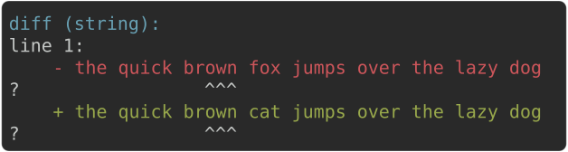
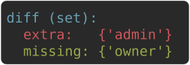
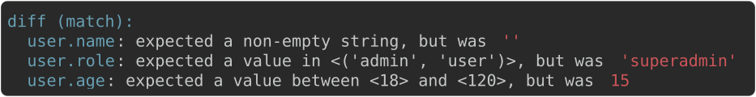

# Errors & Reporting

## Structured errors

A failing assertion raises `AssertionFailure`, a subclass of `AssertionError` that carries structured
data. Existing `except AssertionError` handlers keep working unchanged.

```python
from assertpy2 import AssertionFailure, assert_that

try:
    assert_that(1).is_equal_to(2)
except AssertionFailure as e:
    print(e.actual)     # 1
    print(e.expected)   # 2
```

Catching the subclass is what gives a type checker the structured fields: `except AssertionError`
still runs, but types `e` as the base class, which declares none of them.

For comparisons, a `DiffResult` with path-level entries is attached:

```python
try:
    assert_that({"a": 1, "b": 2}).is_equal_to({"a": 1, "b": 99})
except AssertionFailure as e:
    assert e.diff is not None   # every comparison failure carries one, other failures do not
    entry = e.diff.entries[0]
    print(entry.path, entry.actual, entry.expected)   # b 2 99
```

### Paths a program can follow

`entry.path` is for people and cannot be read back. Keys pass through `str()`, so `{3: "a"}` and
`{"3": "a"}` give the same path, and a key holding a dot or a bracket cannot be parsed.

`entry.steps` is the same location for a program: a tuple of [`Step`][assertpy2.errors.Step], each holding
the key, index, field name, set member or line number itself.

```python
from typing import Any

data = {"users": [{"roles": {7: "admin"}}]}

try:
    assert_that(data).is_equal_to({"users": [{"roles": {7: "guest"}}]})
except AssertionFailure as e:
    assert e.diff is not None
    entry = e.diff.entries[0]
    print(entry.path)                                  # users[0].roles.7
    print([(s.kind, s.value) for s in entry.steps])
    # [('key', 'users'), ('index', 0), ('key', 'roles'), ('key', 7)]

    cursor: Any = e.actual   # `actual` is `object`: the library does not know your payload's shape
    for step in entry.steps:
        cursor = cursor[step.value]
    print(cursor)                                      # admin
```

- Empty `steps` means the whole value differs (its `path` renders as `.`), or the path is a label, not a
  location: a containment failure reports `missing` and `extra`, and an item not in a collection has no
  position in it.
- In a sequence whose sides have shifted apart, an index alone is ambiguous, since the two sides' index
  spaces no longer agree. The step names its `side` (`actual` or `expected`), as the path renders
  `actual[2]` / `expected[1]`, and a resolver must read that side.

The diff is also rendered into the failure **message**, so it travels with `str(e)` wherever the
exception surfaces - `unittest`, a plain script, an `AssertionError` in a CI log:

```python
try:
    assert_that({"a": 1, "b": 2}).is_equal_to({"a": 1, "b": 99})
except AssertionError as e:
    print(e)
    # Expected <{.., 'b': 2}> to be equal to <{.., 'b': 99}>, but was not.
    # diff (dict):
    #   b:
    #     - 2
    #     + 99
```

Each `..` stands for a run of matching parts, where that run was: a one-field change in a wide object reads
`{.., 'b': 2, ..}`. Sequences collapse the same way once they grow past a line or so:

```python
try:
    assert_that(list(range(40))).is_equal_to([*range(27), 999, *range(28, 40)])
except AssertionError as e:
    print(e)
    # Expected <[.., 27, ..]> to be equal to <[.., 999, ..]>, but was not.
    # diff (sequence):
    #   [27]:
    #     - 27
    #     + 999
```

Sequences are aligned first, so an inserted or removed element is reported as itself, not as a mismatch at
every later index:

```python
try:
    assert_that([0, *range(1, 40)]).is_equal_to(list(range(1, 40)))
except AssertionError as e:
    print(e)
    # Expected <[0, ..]> to be equal to <[..]>, but was not.
    # diff (sequence):
    #   actual[0]: - 0
```

A one-sided entry names the sequence its index belongs to. When alignment is used:

- only where a sequence changed length, and only where it reads shorter than comparing by index
- never for a reversal, a coordinate pair or anything else of unchanged length
- never above a thousand elements.

A multi-line value collapses by line, since the message carries it twice:

```python
try:
    assert_that("line 1\nline 2\nline 3\nline 4").is_equal_to("line 1\nline 2\nline THREE\nline 4")
except AssertionError as e:
    print(e)
    # Expected <.., line 3: line 3, ..> to be equal to <.., line 3: line THREE, ..>, but was not.
```

Short values are printed whole, since collapsing them would hide context to save a few characters.

When almost nothing matches there is little to collapse, so the message names the first few differences
and counts the rest as `... and N more`.

Either way every difference stays in the diff, so the shorter message loses nothing.

Matcher-based assertions (`matches_structure()`, `satisfies()`, `each()`) attach a `DiffResult` with
`kind='match'`, where each entry's `expected` holds the failed predicate's description.

`assert_conforms()` attaches one of the same kind:

- A validation failure has an entry per pydantic error.
- An `exact=True` failure has an entry per undeclared field, holding the value the payload sent, with
  `absent == "expected"`. A part that cannot be checked gets a single entry, with the reason in `expected`.

The steps lead into the payload. Two kinds of step hold an object instead of a key or an index:

- `item`: a member of a collection that keeps no positions, or the mapping key a find lies inside.
- `json`: the decoded value of JSON text (`Json[...]`), which the steps after it lead into.

A reader takes `step.value` at both:

```python
def resolve(value, steps):
    for step in steps:
        value = step.value if step.kind in ("item", "json") else value[step.value]
    return value
```

`resolve(payload, entry.steps)` is then the very object `entry.actual` holds, for a payload validation left
as sent.

Where a validator changed the payload in place, the payload is returned to what validation left, so an
entry holding one of its dicts, lists or tuples holds a copy of what was sent instead. An entry inside JSON
text is not copied: it keeps the decoded value the steps after its `json` step lead to.

Under pytest the plugin attaches the diff as a section of its own and keeps the message to one line, so the
diff is never shown twice.

- The section travels with the failure: the terminal, a JUnit report and an IDE runner such as PyCharm's
  show it, for a failing fixture too.
- An exception group, such as two fixtures failing in teardown, gets a section per failure, numbered in
  traceback order: `Structured Diff (2 of 3)`.
- A soft block gets a section per failure it collected, see
  [What a soft block hands back](#what-a-soft-block-hands-back).
- Color comes only from the terminal. A JUnit report, an IDE runner and a CI log without forced color get
  plain text.
- The plugin registers itself through the `pytest11` entry point. No configuration needed.

See [Rich pytest diffs](#rich-pytest-diffs) for supported types and configuration.

## Rich pytest diffs

When `is_equal_to()` or `contains()`/`contains_exactly()` fail, the `DiffResult` on the exception is
rendered by the plugin as diff sections on the failure.

| Type | Diff kind | How it works |
|---|---|---|
| `list`, `tuple` | `sequence` | Element-by-element, recursive into nested dicts, lists, dataclasses, namedtuples, attrs classes, and models |
| `set`, `frozenset` | `set` | Extra and missing items |
| `str` | `string` | Line-by-line, with difflib carets marking the exact intra-line change |
| `dict` | `dict` | Key-by-key, recursive into nested dicts, lists, dataclasses, namedtuples, attrs classes, and models |
| `dataclass` | `dataclass` | Field-by-field, handles differing types with overlapping fields |
| `namedtuple` | `namedtuple` | Field-by-field comparison |
| Pydantic model | `model` | Field-by-field on the values the fields and extras hold, not `model_dump()`, recursive into nested models |
| attrs class | `attrs` | Field-by-field, recursive into nested fields |
| other | `scalar` | Single actual-vs-expected entry |
| `contains` family | `contains` | Missing and extra items, plus the repeat counts for a duplicate failure |
| matcher mismatch | `match` | `satisfies()`, `each()`, `all_satisfy()`, `any_satisfy()`, `satisfies_exactly()`, `zip_satisfies()`, `matches_structure()`, `all_fields_satisfy()`, `assert_conforms()`: path + failed predicate |

```text
--- AssertionFailure ---
  actual:   [{'id': 1, 'name': 'Alice'}, {'id': 2, 'name': 'Bob'}]
  expected: [{'id': 1, 'name': 'Alice'}, {'id': 2, 'name': 'Robert'}]
```

- The section carries the values the assertion named. `failure.actual` always holds the value under test,
  but most messages open with it, so it is not repeated.
- For a failed `is_equal_to()` under `ignore=` or `include=`, the rows are the compared views: without the
  left-out keys, and a record as its fields. `failure.actual` stays the value you passed.
- Beside `tolerance=`, `comparators=`, `strict_types=` or `ignore_null=`, the rows are the two values.

The comparison walks the whole object graph. For a huge payload where a few fields matter, assert on those:
see [When full structural comparison is too much](../recipes.md#when-full-structural-comparison-is-too-much).

### What each diff kind looks like

**Value diffs** (`sequence`, `dict`, `dataclass`, `namedtuple`, `attrs`, Pydantic `model`, `string`,
`scalar`) show the path with the removal in red and the addition in green. This is the diff for the
example above:

![Colored sequence diff: [1].name with the removal in red and the addition in green](../assets/diff-sequence.svg)

Strings are diffed within each changed line, with difflib carets (`? ^^^`) at the exact span, as pytest's
own rewriting does. `bytes` and `bytearray` too, through their `b'...'` form:



Carets appear only while the two lines resemble each other (difflib's 0.75 cutoff). Past that the lines
print plainly.

**Set and contains** show extra items in red and missing items in green:



**Match** (the matcher assertions in the table above) shows each field's path, the failed predicate and
the actual value in red:

- Every mismatch is listed, not just the first. There is no green: a predicate has no "addition".
- An undeclared field found by `assert_conforms(..., exact=True)` has no predicate: `path: - value`.



- Nested structures report the exact path to the differing value, such as `[1].name`.
- A value that leads back into itself is read as far as the sides differ. The way back adds no row.
- Where `==` holds two values apart and nothing inside differs, as with identity-compared instances, the
  row is the pair itself.
- Two unequal values of different types that print the same are tagged with their types:
  `assert_that("1").is_equal_to(1)` reads
  `Expected <1:str> to be equal to <1:int>, but was not.`

!!! note
    Cycle detection covers every walker this library owns:

    - the diff rendering, and the comparison under an option (`ignore`, `include`, `strict_types`,
      `tolerance`, `comparators`), which treat a pair met again inside itself as equal rather than
      recursing, so two values are compared as the trees they unfold into. A key option applies at its
      own level of a cyclic value as it does of a flat one: `ignore="id"` leaves out the `id` of the
      value compared, not the `id` of what it leads back to
    - a contract snapshot, which records a revisited node as `<circular ref>`
    - a value snapshot, which fails with a message naming the cycle, since json cannot represent one

    The bare equality check is not ours: it follows Python's own `==`, so two structurally equal
    *cyclic* graphs raise `RecursionError` exactly as a plain `assert a == b` would.

### The comparison settings are named back to you

`ignore` and `include` appear in the failure sentence. `tolerance`, `comparators`, `ignore_null` and
`strict_types` get a line of their own:

```python
from assertpy2 import assert_that

try:
    assert_that({"price": 1.0}).is_equal_to({"price": 9.0}, tolerance=0.001, strict_types=True)
except AssertionError as failure:
    print(str(failure).splitlines()[1])
    # compared with tolerance=0.001, strict_types=True
```

With default settings nothing is added. The line goes below the sentence, so a `match=` written against
the sentence keeps matching.

### Some failures say why, not only what

A diff says what differs, not why: two strings differing only in a trailing space, or a comparison a NaN
made impossible. Where the whole difference has one explanation, it gets a line:

```python
from assertpy2 import assert_that

try:
    assert_that({"user": {"name": "bob "}}).is_equal_to({"user": {"name": "bob"}})
except AssertionError as failure:
    print(str(failure).splitlines()[1])
    # every difference here is one of surrounding whitespace
```

The line appears only when it explains **every** entry in the diff. A value that is simply wrong gets
nothing, and so does one field differing by whitespace beside another differing in content.

The one a JSON payload produces more than any other is a field that came back as text. The diff shows
`- 7` against `+ '7'` on every row, and the line says it once:

```python
from assertpy2 import assert_that

payload = {"id": 7, "quantity": 3}

try:
    assert_that(payload).is_equal_to({"id": "7", "quantity": "3"})
except AssertionError as failure:
    print(str(failure).splitlines()[1])
    # every difference here is the same text against a value of another type
```

A single value compared on its own says it in the sentence instead, tagging each side with its type
(`Expected <7:int> to be equal to <7:str>`), so the line stays away rather than repeating it.

`NaN` is stated first whatever else differs, since no value on the other side could have made that
comparison pass:

```python
from assertpy2 import assert_that

try:
    assert_that(float("nan")).is_equal_to(float("nan"))
except AssertionError as failure:
    print(str(failure).splitlines()[1])
    # a NaN takes part in this comparison, and a NaN is equal to nothing, not even itself
```

Two values that print the same yet are not equal: a class without `__eq__` compares by identity, so the
expected value your test built never equals the returned one:

```python
from assertpy2 import assert_that


class Order:
    def __init__(self, id, total):
        self.id, self.total = id, total


try:
    assert_that(Order(7, 10.0)).is_equal_to(Order(7, 10.0))
except AssertionError as failure:
    print(str(failure).splitlines()[1])
    # these values compare with object's __eq__, so equality is identity and no two separate instances are equal
```

- It is said first, as `NaN` is: under `object.__eq__`, matching attributes cannot make two separate
  instances equal.
- Exceptions are the everyday case, since they compare by identity too.
- A `comparators=` entry over those values silences it: the verdict is then your predicate's.

One level down, a diff row whose sides print the same is never left alone. Two classes are each printed
with the class, and with the module where the names clash:

```python
from assertpy2 import assert_that


class Kept(dict):
    pass


try:
    assert_that({"a": Kept(x=1)}).is_equal_to({"a": {"x": 1}}, strict_types=True)
except AssertionError as failure:
    print("\n".join(str(failure).splitlines()[-2:]))
    #     - {'x': 1}:Kept
    #     + {'x': 1}:dict
```

Two sides of one class that print the same get a line instead:

- The class leaves `__eq__` to `object`, and no `comparators=` took part: `a difference here prints the same
  on both sides, and the class of the two leaves __eq__ to object, so two separate instances are never equal`.
- Otherwise: the repr does not show the difference, and the attributes that differ are listed.

```python
from assertpy2 import assert_that


class Money:
    def __init__(self, amount, currency):
        self.amount, self.currency = amount, currency

    def __eq__(self, other):
        return (self.amount, self.currency) == (other.amount, other.currency)

    def __repr__(self):
        return f"Money({self.amount})"


try:
    assert_that({"total": Money(5, "EUR")}).is_equal_to({"total": Money(5, "USD")})
except AssertionError as failure:
    print(str(failure).splitlines()[1])
    # a difference here prints the same on both sides, so what holds the two apart is not in their repr (attributes that differ: currency)
```

Where differences repeat down a sequence, a line says where, with positions written `[*]`. Every entry
counts, including those past the fiftieth that are not printed:

```python
from assertpy2 import assert_that

rows = [{"id": n, "name": f"user{n}", "updated_at": f"10:00:{n:02d}"} for n in range(51)]
other = [dict(row, updated_at=f"11:00:{n:02d}") for n, row in enumerate(rows)]
other[50]["name"] = "renamed"

try:
    assert_that(rows).is_equal_to(other)
except AssertionError as failure:
    print(str(failure).splitlines()[1])
    # the 52 differences here are at <[*].updated_at> (51) and <[*].name> (1)
```

It is said for three or more differences at one to three places, under whatever line says why. It names
where and recommends nothing: whether `updated_at` belongs under `ignore=` is your call.

A failed `contains()`, and every assertion that looks for something, gets a line when one fact about the
item not found explains it:

- the item is a NaN
- a candidate reads the same and is of another plain type
- a candidate prints the same, and their class compares by identity.

That holds for `contains()`, `contains_key()`, `contains_only()`, `contains_exactly()`,
`contains_exactly_in_any_order()`, `contains_only_once()`, `contains_sequence()`, `contains_in_order()`,
`is_in()`, `is_subset_of()`, `contains_value()` and `contains_entry()`.

Most of them also name the closest row and what differs, where a row shares a key with the item: dicts,
dataclasses, attrs instances, named tuples and models. Not `contains_sequence()`, `contains_in_order()`,
`contains_key()` or `contains_entry()`. Both lines are said for one item not found, not for several.

Where a key is not found and the value holds one that reads almost the same, the line names it.
`contains_key()`, `contains()` on a mapping, `contains_entry()` and `has_<name>()` (for an attribute too)
say it:

```text
Expected <{'user_id': 2, 'email': 'a@b'}> to contain key <userId>, but did not.
a key reads the same but for how its words are joined: <user_id>
```

What counts as almost the same, narrowest first:

1. The same once both are lowercased.
2. The same once lowercased and with word joints (space, underscore, dot, hyphen) taken out: `userId` and
   `user_id`.
3. One spelling that is nearly the same: two neighbouring letters swapped, a letter too many or too few,
   or a `difflib` ratio of 0.85 once lowercased and unjoined.

The first two are facts, the third is worded as a likeness. Where two spellings come that close, nothing
is said. Keys that differ only in case or joints count as one spelling and are named together: the first
three, and how many more.

Limits:

- Said for one key not found. With several missing, none is named.
- Only plain-text keys are read, and of an object only its public names.
- The likeness is looked for among names of up to a hundred characters.
- `has_<name>()` under `not_`, for a name that is not there, fails as it does without `not_`, line included.

Over the keys of three real payloads, a key asked for with one slip was named in 99.3% of 2529 cases, and
no other key ever was.

`contains_exactly()` and `contains_exactly_in_any_order()` count, and give an item's two counts:

- where everything missing is one item the value does hold: `<'7'> is held 1 time and was asked for 2 times.`
- where nothing is missing and everything left over is one item that was asked for.

```python
import json

from assertpy2 import assert_that

payload = json.loads('{"ids": [7, 8]}')

try:
    assert_that(payload["ids"]).contains("7")
except AssertionError as failure:
    print(str(failure).splitlines()[1])
    # an element reads the same as the item not found and is of another type: int, not str

try:
    assert_that("7").is_in(*payload["ids"])
except AssertionError as failure:
    print(str(failure).splitlines()[1])
    # a given item reads the same as the value and is of another type: int, not str
```

A failed `contains_entry()` says what the key holds, or that the key is not there.

A failed `has_<name>()` fails as `is_equal_to()` on the value it read:

- The failure carries that value, the operand and their diff. Two values that print the same are told
  apart by class.
- Two dicts print as `is_equal_to()` prints them, matching keys collapsed to `..`. So do two lists or plain
  tuples too long to print whole.
- If the collapsed texts read alike, or the values cannot be compared a second time, both print as texts,
  cut around where they part.
- If the two cannot be read a second time, the diff is one entry: the pair itself.

A text held against a text is explained the same way. Where the relation asked holds once one thing is
set aside, the line names that thing:

```text
Expected <Total: 42 EUR> to contain item <Total: 42>, but did not.
the value holds it once every run of whitespace is read as one space
```

The space after `Total:` in the value is a no-break space, which the sentence cannot show.

| Assertion | Names |
|---|---|
| `starts_with()`, `ends_with()` | whitespace at that end of the value (a single `\n`, `\r\n` or `\r` is a line break), case, whitespace at an end of the text given, or that the text is somewhere else in the value |
| `contains()` on a text | case, or that each run of whitespace must be read as one space (a line break, a tab, a no-break space, two spaces), or both |
| `starts_with_ignoring_case()`, `ends_with_ignoring_case()`, `contains_ignoring_case()` | all of the above but case |
| `is_equal_to_ignoring_case()` | the whitespace still holding the two apart |
| `is_equal_to_ignoring_whitespace()` | case |
| `is_equal_to()` on two texts | line endings, surrounding whitespace, and the kind or amount of whitespace |

- One fact is said, the narrowest. Two at once get no line, such as a leading space plus another case for
  `starts_with()`. Only `contains()` has a line for case and whitespace together, and equality for line
  endings and surrounding whitespace.
- Only plain text gets these lines. A `str` subclass, bytes and the first element of a list get none.
  `is_equal_to()` still reads bytes and any `str` subclass as before.

Two moments say how far apart they are. `is_before()`, `is_after()` and their `_or_equal_to` twins
give the distance on the other side, or say that the two are the same moment:

```text
Expected <2026-01-01 12:00:00+00:00> to be before <2026-01-01 13:30:00+02:00>, but was not.
the value is 0:30:00 after the moment given
```

`is_close_to()` and `is_not_close_to()` on two datetimes give the distance and how far it is from the
tolerance:

```text
Expected <2026-01-01 12:00:00> to be close to <2026-01-01 12:00:07> within tolerance <0:00:05>, but was not.
the two are 0:00:07 apart, 0:00:02 more than the tolerance
```

- The distance is `datetime`'s own subtraction, exact to the microsecond, printed as a `timedelta`.
- It is said only where `datetime` itself made the verdict. A subclass with its own comparison, such as a
  pandas `Timestamp`, gets no line.
- A subclass with its own `-` or `+`, such as pendulum's, gets the ordering line but not the closeness line.
- The tolerance has to be exactly a `timedelta`.

`is_less_than()`, `is_greater_than()` and their `_or_equal_to` forms, which take two datetimes as well,
say of them what `is_before()` and its kin say. `is_between()` says nothing.

Python compares two datetimes that share one zone object on their wall clocks. Across a clock change that
is not the time between them, and the two readings of a repeated hour compare equal. The line then speaks
of the clock:

```text
Expected <2026-10-25 02:30:00+02:00> to be before <2026-10-25 02:30:00+01:00>, but was not.
the two read the same on the clock they share
```

- Two in different zones are compared as moments, and the line gives the time between them.
- The line asks a zone for its offset only for `datetime.timezone` and `zoneinfo.ZoneInfo`.
- With a zone of another library, such as pytz's or dateutil's, two sharing it get the clock line, and two
  in different zones get none.

A third line appears when the value came from an HTTP response, naming the request it answered:

```text
Expected <500> to be equal to <200> on attribute <status_code>, but was not.
from GET https://api.example.com/orders/7 -> 500
```

It survives the step into the body: a failure under
[`decoded_as_json()`](../recipes.md#test-an-http-api-response) still names the call. It reads no body and
starts no I/O, so an unread streaming response is safe to assert on.

Like the settings echo above, these sit below the sentence, so anything written against the original
message keeps working.

### Polling failures carry a trace

An [`eventually()`](testing.md#async-assertions) timeout carries `failure.trace`: a
[`PollTrace`][assertpy2.errors.PollTrace] with a [`PollSample`][assertpy2.errors.PollSample] per poll and a
one-line trend. See [Polling trace](testing.md#polling-trace).

### The comparison window of an IDE

pytest calls the hook `pytest_assertrepr_compare` for a failed `assert left == right`, and runners with a
two-pane comparison listen to it. A failed `is_equal_to()` is the same comparison, so the plugin hands them
the two values: the value under test as `left`, the operand as `right`.

In PyCharm, a failed `assert_that(actual).is_equal_to(expected)` gets the same "Click to see difference"
link as `assert actual == expected`. The window shows the operand under Expected and the value under
Actual, both whole, and PyCharm prints the two values above the link. Seen in PyCharm 2026.3 on a response
of forty nested rows.

What is handed over is the pair the assertion compared:

| Failed assertion | The two panes show |
|---|---|
| `is_equal_to()` | the value and the operand |
| `is_equal_to()` under `ignore=` or `include=` | the two copies without the keys left out, so a key the assertion passed over is in neither pane |
| `has_<name>()` | the value it read and the operand |

- A record in a copy made under `ignore=` or `include=` (a dataclass, an attrs class, a model) is handed
  over as the dict of its fields, which is what was compared. The pane lays it out line by line, in the same shape as a dict beside it.
- That holds for mappings whose keys are exactly `str`, `int`, `bool`, `float`, `bytes` or `None`. A
  mapping with any other key, a subclass of those included, is handed over as it was.

The window compares two texts, as it does for a plain `assert`:

- two values `==` holds equal that print differently, `1` and `True`, show there as a difference
- two that differ and print the same, two NaNs, show as none

The failure's own diff is the one built from the comparison.

Nothing is handed over in three cases:

- under `tolerance=`, `comparators=`, `strict_types=` or `ignore_null=`, where a text comparison of two
  values would show a difference the assertion let pass, or none where it found one
- for a negation, a membership assertion or a `soft_assertions()` block
- for a group of several failures

The failure is what it was there: its message, `failure.diff` and the report sections do not change.

Who hears the hook:

- It is called while the report of the test is being made, before it is logged. A listener that reads
  the pair when the report is logged hears it, which is how PyCharm's runner reads.
- Under `pytest-xdist` it is called in the worker, and a runner that reports from the controller does
  not hear it.
- `assertpy2_comparison = "off"` turns the hand-over off.

### Catching failures with their types intact

`pytest.raises(AssertionError)` types the exception as plain `AssertionError`, so a checker flags
`.actual`, `.expected` and `.diff`. Catch `AssertionFailure`: every failure is raised as it, a soft block's
and `fail()` included:

```python
import pytest
from assertpy2 import AssertionFailure, assert_that

def test_diff_is_machine_readable():
    with pytest.raises(AssertionFailure) as exc_info:
        assert_that({"role": "guest"}).is_equal_to({"role": "admin"})

    failure = exc_info.value  # typed as AssertionFailure
    diff = failure.diff
    assert diff is not None   # optional on the class, present on every comparison failure
    assert_that(diff.kind).is_equal_to("dict")
    assert_that(diff.entries[0].path).is_equal_to("role")
```

The rich diff comes from the fluent form. With the `==` drop-in for matchers
(`assert response == {"id": match.is_positive()}`), pytest renders its own comparison, without the path.

### What the failures had in common

Forty failing tests are usually not forty problems. Where three or more of them differ at the same
place, the run ends with a line saying where:

```text
assertpy2 failure clusters:
  37 of 40 failing tests differ at user.role
      actual:   'superadmin'
      expected: 'admin'
  3 of 40 outside any cluster of 3
```

You get that without configuring anything. Three is the floor rather than a rule, and it moves:

```toml
[tool.pytest.ini_options]
assertpy2_failure_clusters = "5"   # failing tests a cluster must hold before it is printed, or "off"
```

Two failures share a cluster only when their difference is *equal*, never merely similar. Without a place
to key on, the printed text is compared: two values with the same `repr` count as one.

**Failures are grouped by the place they differ at, not by their values.** A broken formula differs at one
field with a value of its own per test. Grouping by values would scatter it into forty clusters of one.
Where a cluster's values disagree, the summary says so:

```text
  12 of 12 failing tests differ at order.total
      actual:   118.4 and 11 other values
      expected: 120.0
```

Row indexes and line numbers are generalised: `users[0].role` and `users[7].role` are one difference.

What the summary will and will not claim:

- **Three kinds of difference carry no location**: a containment failure (`missing` or `extra`), a set
  entry and a scalar failure. They group on the failure's
  [diagnostic line](#some-failures-say-why-not-only-what) when it has one. Five uploads differing only by a
  trailing newline read as one cause: `5 of 5 failing tests share one scalar difference`.
- **Containment and set differences without a diagnostic stay out.** Their fields hold presence, not
  values, so a heading would claim your value was `None`.
- **The floor is a count, not a share of the run.** With a share, forty failures splitting into five
  causes of eight would print nothing.
- **The share counts every red test**, fixture errors included: `10 of 13 outside any cluster of 3` says ten
  failing tests fell outside any cluster of three or more. The floor is named because two tests sharing a
  difference under it were declined, not missing.
- **Tests, not reports.** A test failing its assertion and then erroring in teardown counts once.
- A failed collection is named on its own line: `1 collection error, not counted below`. That happens only
  under `--continue-on-collection-errors`.
- Under `pytest-xdist`, a worker killed mid-run ships nothing, and one on another version of this library
  can ship something unreadable. The summary says so:

```text
assertpy2 failure clusters:
  1 worker died, so these counts cover only what was reported
  6 of 6 failing tests differ at user.role
```

Everything printed is bounded, because a diagnostic that grows with the run hurts the worst runs most:

- values longer than 200 characters are cut
- a cluster reports a floor rather than a count past 64 distinct values per side (`and 64+ other values`)
- at most five clusters print, followed by a count of the rest

What a cluster is keyed on is not cut: two payloads sharing their first 200 characters are still two
failures. The failure message and the structured diff keep their values whole.

Nothing here can fail a run. If the summary cannot be built, a warning says so and the run's own results
are untouched.

A passing run pays nothing, since there is no failure to record. A failing run reads each failed diff once
(2.3 µs for one differing entry, 0.11 ms for fifty) and builds the summary once (15 µs for forty failing
tests). Turned off, nothing is read.

### Configuration

Two settings guard against a test that passes without checking anything: the dangling detector and the
vacuous-quantifier warning. Both are off by default, since either can turn a green run red. A new suite
turns both on in one line:

```toml
[tool.pytest.ini_options]
assertpy2_profile = "safe"   # dangling on, vacuous on (default "compatible": both off)
```

- A setting you name wins over the profile: `safe` plus `assertpy2_dangling = "off"` keeps only the other.
- Failure clustering needs no profile: it reads only red runs. `assertpy2_failure_clusters = "off"` turns it
  off.

### Seeing them, and being stopped by them

`safe` warns, so a run full of findings still exits zero, unless the suite has
`filterwarnings = ["error"]`. `strict` turns on the same two guards and fails the tests they find:

```toml
[tool.pytest.ini_options]
assertpy2_profile = "strict"
```

The two read differently in the report, because they are found at different moments:

```text
ERROR test_orders.py::test_the_total    DanglingAssertionWarning
FAILED test_orders.py::test_every_item  VacuousAssertionWarning
```

- A dangling chain is found at collection and reported at setup, so the test never runs: an error.
- A vacuous pass is found while the assertion runs: a failure.
- The `strict` profile escalates only these two warnings. A `DeprecationWarning` elsewhere stays as it was,
  which a blanket `filterwarnings = "error"` would not do.

```toml
[tool.pytest.ini_options]
assertpy2_diff = "off"              # disable structured diff sections entirely
assertpy2_diff_max_entries = "100"  # max entries to show (default 50, 0 = unlimited)
assertpy2_comparison = "off"        # do not hand a failed equality to comparison listeners
assertpy2_poll_report = "off"       # silence the near-timeout poll report (default 0.7)
assertpy2_failure_clusters = "off"  # stop grouping failures that share one difference (default 3)
assertpy2_dangling = "on"           # warn about assert_that() statements that assert nothing
assertpy2_dangling_entries = "check"  # your own assert_that wrappers, for the check above
assertpy2_vacuous = "on"            # warn when a universal assertion passes over an empty value
```

- In a color terminal or with `--color=yes`, diffs are colored: red removals, green additions, cyan headers.
  Every other reader gets plain text.
- Entries past the limit become `... and N more entries`.

The plugin also adds `assertpy2_allure` (see [Allure](../extending/integrations.md#allure)) and these flags:

| Flag | What it does |
|---|---|
| [`--assertpy2-vacuous`](assertions.md#assertions-that-checked-nothing) | Warn when a universal assertion passes over an empty value, or `is_equal_to` compares nothing |
| [`--assertpy2-dangling`](assertions.md#assertions-that-never-ran) | Warn when `assert_that()` is written as a statement that asserts nothing |
| [`--assertpy2-snapshot-update`](testing.md#snapshot-testing) | Overwrite failing snapshots with the current values |
| [`--assertpy2-snapshot-ci`](testing.md#snapshot-testing) | Fail instead of creating a missing snapshot (auto-enabled on CI) |
| `--assertpy2-snapshot-no-ci` | Disable CI mode and its autodetection |

## What a failure exposes

A failing assertion shows the values it compared, and that output reaches CI logs, report attachments and,
for snapshots, committed files. Below is what travels where.

**assertpy2 caps size. It never redacts.** Nothing guesses whether a value looks like a credential: a
wrong guess either hides the difference you are debugging or leaks what you thought was masked.

### The channels

| Channel | Carries | Reaches |
|---|---|---|
| the message, `str(failure)` | the differing values, capped | pytest output, CI logs, anything catching `AssertionError` |
| `failure.actual` / `failure.expected` | the **whole untouched values** | the pytest report section, Allure attachments, your own `except` block |
| `failure.diff` | per-path actual and expected, capped when rendered | the same |
| a snapshot file | the serialised value | `__snapshots/*.json`, normally committed |

The caps are on rendering only. Values, patterns and item lists print whole up to 4000 characters. Past
that the message says how much it left out, and keeps:

| What a message prints | What it keeps past the cap |
|---|---|
| the two sides of `is_equal_to` | the first 4000 characters, with the rest left to its diff |
| two texts held against each other: `starts_with`, `ends_with`, the comparisons that ignore case or whitespace | a cut around the place they part |
| anything else | its first 3000 and last 1000 |
| a name or a count you pass: a key, a class, a file, a length | all of it, as given |

A diff has caps of its own:

| Part of a diff | Cap |
|---|---|
| a row | 400 characters |
| a row a `soft_assertions()` block keeps | 4000 a side |
| the whole block | 20 KB |
| matching parts of a structure | collapse to `..` |

- None of that shrinks `failure.actual`, which is what a reporting integration serialises.
- Under `pytest -vv`, a message and the report section's values print whole (under `ignore=` or
  `include=` alone, the two compared views). Diff rows stay cut.

### Keeping a value out

Excluding a key from the comparison also excludes it from the message and the diff:

```python
from assertpy2 import AssertionFailure, assert_that

payload = {"user": "alice", "api_key": "sk-live-9f3b2a7c", "n": 1}
expected = {"user": "alice", "api_key": "sk-live-different", "n": 2}

try:
    assert_that(payload).is_equal_to(expected, ignore="api_key")
except AssertionFailure as failure:
    print("sk-live" in str(failure))   # False: the key was never compared, so it is not reported
    print("sk-live" in str(failure.actual))  # True: the object you passed is unchanged
```

- `ignore` and `include` govern the report as well as the verdict, so the value stays out of the log.
- The exception still holds your original objects. The library does not copy them.
- For anything stronger, redact before asserting: compare a filtered copy, or wrap the value in a type
  whose `__repr__` prints a placeholder.

### Turning channels off

`assertpy2_diff = "off"` drops the diff section from pytest reports, and `assertpy2_allure = "off"` stops
attaching values to Allure. The message stays intact, so neither replaces not passing the value in.

## Failure and expected exceptions

### fail()

Force a test failure explicitly:

<!-- docs-guard: skip -->
```python
from assertpy2 import fail

fail("forced failure")
```

### Expected exceptions

For a called function, assert it raises and chain assertions on the message:

<!-- docs-guard: skip -->
```python
assert_that(some_func).raises(RuntimeError).when_called_with("foo")
assert_that(some_func).raises(RuntimeError).when_called_with("foo").is_equal_to(
    "some err"
)
```

The caught message is the value the chain holds, so the message pattern `pytest.raises(ValueError,
match=...)` takes beside the class is a step of its own here, a search as `re.search` makes one:

<!-- docs-guard: skip -->
```python
assert_that(parse).raises(ValueError).when_called_with("x").matches(r"invalid literal")
```

Or assert it does **not** raise a given exception:

<!-- docs-guard: skip -->
```python
assert_that(safe_func).does_not_raise(ValueError).when_called_with("foo")
```

- `does_not_raise(ValueError)` is about that one exception: a call raising another passes, and that other
  exception goes unreported. For a call that must complete, use `does_not_raise(Exception)`.
- Both take a tuple or a union of classes, any one of which answers: `raises((TimeoutError,
  ConnectionError))` holds when either is raised, `does_not_raise(KeyError | IndexError)` fails on either.
- An empty tuple is refused.
- With several classes, a type checker reads the caught exception as `BaseException`.

!!! tip
    For the common "did it raise?" case without inspecting the message, prefer pytest's
    `pytest.raises` context manager.

Beyond the message, the caught exception can be inspected in three more ways.

**The exception object** - `raised()` pivots to the caught exception itself, so you can assert on its
type, `args`, or custom attributes, not only its message string:

<!-- docs-guard: skip -->
```python
err = assert_that(load).raises(ConfigError).when_called_with("bad.toml").raised().value
assert_that(err.code).is_equal_to(42)
```

A type checker reads `err` as the `ConfigError` that `raises()` named, and after `caused_by()`,
`has_root_cause()` or `error_of()` as the type that step asked for.

**The cause chain.** `caused_by()` asserts a direct cause (`raise ... from`, or raised during handling).
`has_root_cause()` walks to the root. Both pivot to that cause's message:

<!-- docs-guard: skip -->
```python
# def save(row): ... raise ServiceError("save failed") from TimeoutError("db timeout")
assert_that(save).raises(ServiceError).when_called_with(row).caused_by(TimeoutError)
assert_that(save).raises(ServiceError).when_called_with(row).has_root_cause(
    TimeoutError
).is_equal_to("db timeout")
```

Both also take a union or a tuple: `caused_by(TimeoutError | ConnectionError)`. A type checker then reads
the cause as `BaseException` (Pyrefly keeps the union).

**Exception groups** (`ExceptionGroup`, Python 3.11+, e.g. from an `asyncio.TaskGroup`):

- `contains_error()` asserts the group holds an exception of each given type, `does_not_contain_error()`
  that it holds none. Both search the whole tree, nested groups included.
- Each argument may be a tuple or a union: `contains_error((ValueError, KeyError), OSError)` asks for one of
  the first two, and an `OSError`.
- `errors()` pivots to the leaves as a list, for every collection assertion.
- `error_of()` picks the first exception of a type and continues on its message. `raised()` gives the object.

<!-- docs-guard: untyped -->
```python
def run_tasks():
    raise ExceptionGroup("2 tasks failed", [ValueError("bad id"), KeyError("missing")])


caught = assert_that(run_tasks).raises(ExceptionGroup).when_called_with()
caught.contains_error(ValueError, KeyError)
caught.does_not_contain_error(TimeoutError)
caught.errors().is_length(2)
caught.error_of(ValueError).contains("bad id")
```

`errors()` flattens nesting, so a count is over the failures, not the shape. `contains_error()` and
`error_of()` search groups too, so the two always agree whether a type is there.

To assert the shape, `matches_error_tree()` takes one entry per member:

- A nested group is a plain `list` of types (a tuple means "any of these").
- Nothing may be left over on either side.
- A type entry matches a subgroup by `isinstance`, as it matches a leaf. Only a nested list looks inside:
  `matches_error_tree(Exception)` holds for any group of one member.

<!-- docs-guard: untyped -->
```python
def run_tasks():
    raise ExceptionGroup("failed", [ValueError("bad id"), ExceptionGroup("retries", [KeyError("missing")])])


caught = assert_that(run_tasks).raises(ExceptionGroup).when_called_with()
caught.contains_error(ValueError, KeyError)
caught.matches_error_tree(ValueError, [KeyError])
```

`contains_error()` passes whatever the nesting. `matches_error_tree()` would notice `KeyError` leaving
`retries`. Entries pair with members, not by order: `matches_error_tree(Exception, ValueError)` and
`matches_error_tree(ValueError, Exception)` both hold for a `ValueError` and a `KeyError`.

### Expected warnings

For a called function, assert it emits a warning and chain assertions on the warning message:

<!-- docs-guard: skip -->
```python
assert_that(deprecated_func).warns(DeprecationWarning).when_called_with("foo")
assert_that(deprecated_func).warns(DeprecationWarning).when_called_with("foo").matches(
    "since 2.6"
)
```

The category defaults to `Warning` (any warning), matches subclasses, and may be a tuple or a union. Or
assert it does **not** emit a category:

<!-- docs-guard: skip -->
```python
assert_that(safe_func).does_not_warn(DeprecationWarning).when_called_with("foo")
```

To also assert on the value the call returned (alongside the warning, or after `does_not_warn` /
`does_not_raise`), pivot with `returned()`:

<!-- docs-guard: skip -->
```python
(
    assert_that(make_client).warns(DeprecationWarning).when_called_with()
    .returned().is_instance_of(Client)
)
(
    assert_that(adder).does_not_raise(TypeError).when_called_with(1, 2)
    .returned().is_equal_to(3)
)
```

`returned()` hands back a builder over the returned value, so its own assertions apply: `contains()` on a
returned list, `starts_with()` on a returned string.

- A type checker reads `.value` as the callable's declared return type.
- The builder is the full one, not the typed view `assert_that()` would pick. A checker accepts any
  assertion on it, and one the value cannot answer raises at run time.
- If the call raised, `returned()` raises `TypeError`: there is no return value.

!!! warning "Not thread-safe"
    `warns()` / `does_not_warn()` rely on `warnings.catch_warnings()`, which mutates process-global
    state.

    They are safe within a single thread, including multiple `asyncio` tasks on one event loop.
    Concurrent use across OS threads can interfere, the same limitation `pytest.warns` and
    `unittest.assertWarns` carry.

### Custom error messages

`described_as()` prepends a custom label to the failure message:

<!-- docs-guard: skip -->
```python
assert_that(1 + 2).described_as("adding stuff").is_equal_to(2)
# [adding stuff] Expected <3> to be equal to <2>, but was not.
```

### What a soft block hands back

A [`soft_assertions()`](testing.md#soft-assertions) block renders its failures into one numbered message.
The raised `AssertionFailure` also carries `failures`: one
[`AssertionOutcome`][assertpy2.outcome.AssertionOutcome] per failure, in the order collected.

```python
from assertpy2 import AssertionFailure, assert_that, soft_assertions

try:
    with soft_assertions():
        assert_that({"role": "guest"}).is_equal_to({"role": "admin"})
        assert_that("foo").is_length(4)
except AssertionFailure as e:
    print(len(e.failures))                       # 2
    first_diff = e.failures[0].diff
    assert first_diff is not None
    print(first_diff.entries[0].path)            # role
    print(e.failures[1].message)                 # Expected <foo> to be of length <4>, but was <3>.
```

Each record keeps the values, the diff, the `group` label, the `(file, line)` and, for a poll that timed
out, its [`trace`](testing.md#polling-trace).

Off pytest, each entry of the message carries its diff in the block form a single failure prints. For
the block above, `str(e)` reads:

```
soft assertion failures:
1. Expected <{'role': 'guest'}> to be equal to <{'role': 'admin'}>, but was not.  [test_app.py:6]
   diff (dict):
     role:
       - 'guest'
       + 'admin'
2. Expected <foo> to be of length <4>, but was <3>.  [test_app.py:7]
```

Room in one message:

- Blocks for twenty failures and 60 000 characters. Past that, a failure keeps the compact form (one line
  per differing path), and the last line of the message names it.
- A block too wide for what is left also keeps the compact form. It takes one of the twenty but none of
  the characters, so a smaller block after it still fits.
- Every block is a `print` away: `print(e.failures[20].diff)`. `diff` is `None` on a failure without one,
  such as `is_true()` on `False`.
- An exception of yours that escapes the block gets the same text as a note.

Under pytest the message keeps the compact form, and the plugin hangs the blocks on the report:

- Each collected failure gets the sections a raised failure gets, numbered as in the message:
  `Structured Diff (failure 2 of 3)`. A section opens on that failure's line, with its group in brackets.
- Under `ignore=` or `include=`, a section shows the two copies the assertion compared.
- The room is the same, twenty failures and 60 000 characters, shared by every soft block failing in one
  report. A block with failures left out gets one more section naming them. A failure with nothing to show
  takes no place among the twenty.
- An exception of yours that escapes the block brings what the block had collected, with their sections.

In the compact form, what each kind of value adds:

- a scalar, or a short line of text, adds no line at all, since the entry above already carries both
  values in full
- a long line adds one, cut to a window around the first difference, which is the part nobody finds by
  reading a 200-character payload twice

`failures` is empty on every other failure, which is about one value rather than a collection of them.

### Asking instead of asserting

`check()` returns the next assertion's verdict as an [`AssertionOutcome`][assertpy2.outcome.AssertionOutcome]
instead of raising: truthy when it held, with the message, values and diff when it did not.

```python
outcome = assert_that({"role": "guest"}).check().is_equal_to({"role": "admin"})

print(bool(outcome))          # False
print(outcome.message)        # Expected <{'role': 'guest'}> to be equal to <{'role': 'admin'}>, but was not.
assert outcome.diff is not None
print(outcome.diff.entries[0].path)   # role
```

- Use it outside tests: branching on a precondition, or reporting into something that is not pytest. A
  false outcome does not stop anything, so inspect it. Where an unmet requirement should fail the test,
  use a plain assertion.
- Negation works: `assert_that(5).check().not_.is_positive()`.
- A bad argument still raises `TypeError` or `ValueError`: the call is wrong, not the value.
- A failed check does not mark the value unverified, unlike a soft or warned failure: `.value` keeps
  working.

### What was asked, as data

`message`, `actual`, `expected` and `diff` say what failed and what the values were, but not what was
*asked*. `expected` cannot, since what it holds depends on the assertion:

| Assertion | `expected` holds |
|---|---|
| `is_equal_to(2)` | the operand |
| `contains(2)` | a tuple |
| `satisfies(...)` | a rendered description |
| `is_instance_of(str)` | a type |
| `is_empty()` | nothing at all |

`requirement` answers that in one shape, on every failure, whichever mode delivered it:

```python
outcome = assert_that(1).check().is_close_to(9, 0.1)
assert outcome.requirement is not None

print(outcome.requirement.operation)    # is_close_to
print(outcome.requirement.parameters)   # {'other': 9, 'tolerance': 0.1, 'rel': None}
print(outcome.requirement.negated)      # False
```

The same three fields are on the raised [`AssertionFailure`][assertpy2.errors.AssertionFailure], on each
entry of a soft block's `failures` and in the Allure attachment. A report can group failures without
parsing messages: every `is_close_to` failure carries the same operation, and a negated one is marked.

Two details worth knowing before you build on it:

- Parameters are the values the assertion **ran with**, keyed by its own parameter names. One left out
  appears with its default, and `is_close_to(9, 0.1)` reads the same as
  `is_close_to(other=9, tolerance=0.1)`.
- An assertion that delegates answers its own name: `is_positive()` asks `is_greater_than(0)`
  underneath, and reports `is_positive`.

`requirement` is `None` where the failure is not one assertion's, and that is a limit rather than a
gap:

| Failure | Its `requirement` |
|---|---|
| `fail()`, `soft_fail()`, a bare `error()` carrying a message of your own | `None`, since they name no operation |
| a precondition of one of the few members that assert nothing on their own | `None`, since it is about the shape of the value rather than about a requirement you stated |
| what a soft block or `assert_all` raises for everything it collected | `None`, with the answer on each entry in its `failures` |
| a polling timeout | that of whatever its last attempt raised: usually the assertion that kept failing, and `None` when the probe raised something that is not one of this library's failures, such as an exception it was told to ignore or a bare `AssertionError` |

A built-in assertion pays nothing for it when it passes. A registered extension pays a wrapper on every
call, passing or failing.

### Warnings instead of failures

For defensive assertions outside tests, replace `assert_that` with `assert_warn`: failures log a
warning instead of raising:

```python
assert_warn("foo").is_length(4)   # logs a warning, does not raise
```

!!! note "`assert_warn()` vs `warns()`"
    These are unrelated despite the similar names.

    `assert_warn(...)` is a *soft* entry point. The assertion still checks your value, but logs a
    warning instead of raising on failure.

    `assert_that(func).warns(...)` goes the opposite way. It asserts that calling `func` *emits* a
    Python warning.

??? note "Warning output and custom logger"
    ```
    2019-10-27 20:00:35 WARNING [app.py:42]: Expected <foo> to be of length <4>, but was <3>.
    ```

    Pass your own logger for custom formatting:

    <!-- docs-guard: skip -->
    ```python
    assert_warn("foo", logger=my_logger).is_length(4)
    ```

    The `assertpy2` logger carries its own handler and also propagates, so if your suite calls
    `logging.basicConfig()` each warning is printed twice. Turning propagation off silences the
    duplicate:

    ```python
    logging.getLogger("assertpy2").propagate = False
    ```

    That trade is yours to make: propagation is also how pytest's `caplog` fixture receives these
    records, so turning it off stops you asserting on them.

#### Handing each failure to your own code

`on_failure` takes a callable instead of a logger. It gets each failure as an
[`AssertionOutcome`][assertpy2.outcome.AssertionOutcome]: the message, the values, the diff, the
[`requirement`](#what-was-asked-as-data) and the `(file, line)`. A logger that should carry the record
takes it from there:

```python
import logging

from assertpy2 import assert_warn

log = logging.getLogger("checks")


def report(outcome):
    text = outcome.message if outcome.diff is None else f"{outcome.message}\n{outcome.diff}"
    log.warning(text, extra={"assertpy2_outcome": outcome})


assert_warn({"status": 500}, on_failure=report).is_equal_to({"status": 200})
```

- Every link of a chain is handed over, pivots and `extracting()` included.
- A polling timeout comes with its [`trace`](testing.md#polling-trace).
- The value is marked unverified before your callable runs, as with a logged failure.
- An exception your callable raises comes out of the assertion that failed.
- `on_failure` replaces `logger`. Passing both is a `TypeError`.
- Through a `LoggerAdapter`, the record keeps your `extra` only with `merge_extra=True` (Python 3.13+).

### Logging the assertions that pass

Inside a [`log_passes()`][assertpy2.assertpy.log_passes] block, every assertion that holds logs one line: the
call, the value, where it was asked and, for a threshold, how far the value was from it. Failures behave as they
do outside.

```python
from assertpy2 import assert_that, log_passes

latency, status = 0.42, 200
with log_passes():
    assert_that(latency).is_less_than(0.5)
    assert_that(status).is_equal_to(200)
    assert_that(98.7).is_close_to(100, 2)
```

Each line goes to the `assertpy2.passes` logger at `INFO`:

```
[test_api.py:5]: is_less_than(0.5) passed for <0.42>, the value is about 0.08 below the number given
[test_api.py:6]: is_equal_to(200) passed for <200>
[test_api.py:7]: is_close_to(100, 2) passed for <98.7>, the two are about 1.3 apart, about 0.7 less than the tolerance
```

**Seeing the lines.** pytest hides the log of a passing test. Turn on live logging for one run with
`pytest -o log_cli=true --log-cli-level=INFO`, or for good:

```toml
[tool.pytest.ini_options]
log_cli = true
log_cli_level = "INFO"
```

Outside pytest, configure a handler: `logging.basicConfig(level=logging.INFO)` for a script. `logger=` and
`level=` send the lines elsewhere. The default logger is a child of `assertpy2`, so turning off that one's
propagation, as the section above suggests for warnings, keeps these lines from your handlers as well.

**Where the distance is given.**

- Assertions: `is_less_than()`, `is_greater_than()`, `is_before()`, `is_after()` and their `_or_equal_to`
  forms, `is_between()` and `is_not_between()`, `is_close_to()` and `is_not_close_to()`.
- Values: standard-library numbers, `datetime`, `date` and `timedelta`.
- Exact: a float counts as the binary number it holds, so `0.5 - 0.42` reads `about 0.08`. Up to 34 digits are
  printed exactly.
- No distance for: `numpy` scalars, subclasses of `int`, a range of dates, numbers past about `10**1000` or below
  about `10**-1000`, a `Fraction` with parts that long, a `Decimal` of more than a thousand digits, and durations
  whose distance overflows `timedelta`.

**What makes a line.**

- One line per assertion you wrote. `is_positive()` is one line, though it calls `is_greater_than(0)`. So is an
  extension, or `all_satisfy()` with what its predicate asserts. Under an assertion that reports nothing, of
  a builder made before the block or kept past it, an assertion made inside the block reports on its own.
- Only passes: a failure a soft block collects, one `assert_warn()` logs, and anything under `check()` log nothing.
- A negation reads `not_.is_less_than(2) passed`.
- A chain logs one line per link, up to the one that failed.
- A poll logs each step of the attempt that passed, once, with the value that attempt read. A blocking
  `eventually_sync()` chain polls again at every assertion called on it and logs the step that assertion
  added.

**Which assertions a block sees.** Like a soft block, it belongs to its thread or `asyncio` task, and tasks
started inside share it.

- A builder reports into the block it was made in, while that block is open.
- A builder made before the block, or kept after it, reports nothing.
- A pivot such as `extracting()` reports where its parent reports.

**Cost.** With no block open anywhere, `assert_that()` makes the builder it made before, and a pivot, a
negation, an extension call and a poll attempt each check one counter. With a block open in some thread, each
`assert_that()` checks its context once. Inside a block, each assertion pays for being observed, and a builder
kept past its block still runs through the observation, reporting nothing.

#### Handing each pass to your own code

`on_pass` takes a callable instead of a logger. It gets each pass as an
[`AssertionOutcome`][assertpy2.outcome.AssertionOutcome]: `passed` set, the value, the
[`requirement`](#what-was-asked-as-data), the `(file, line)` and the distance as `hint`. `message` is empty, as
on every passing outcome.

```python
from assertpy2 import AssertionOutcome, assert_that, log_passes

checked: list[AssertionOutcome] = []
with log_passes(on_pass=checked.append):
    assert_that(0.42).is_less_than(0.5)

assert checked[0].requirement is not None
assert checked[0].requirement.operation == "is_less_than"
assert checked[0].hint == "the value is about 0.08 below the number given"
```

- `on_pass` replaces `logger`. Passing both is a `TypeError`.
- An exception your callable or logger raises comes out of the assertion that passed.
- Assertions your callable or logger make are not reported.
- Read the record, not the text. The line is wording and may change, see [stability](../concepts/stability.md).
- A line calls `str()` on the value and `repr()` on the arguments, as a failure message does. A secret in a value
  ends up in the log. Nothing is rendered when the logger does not want the level.

??? note "Inside a poll"
    - An attempt holds the passes made in its own context and in the tasks it starts. Only the attempt that
      passed hands them on, after the poll. An exception your callable or logger raises then comes out once
      and is not retried.
    - That holds for blocks open before the attempt began. A block entered during the attempt, by the probe or
      beside it, hands its passes on at once. What its callable or logger raises, once it reaches the probe,
      is part of the attempt, which the poll retries.
    - The same goes for an assertion the probe runs in another context, through `Context.run()` or a thread. An
      exception raised in another thread reaches the probe only if the probe passes it on, which
      `Thread.join()` does not.
    - An assertion of a builder made in an outer block is rendered when checked. The outer block's logger is
      asked after the poll.
